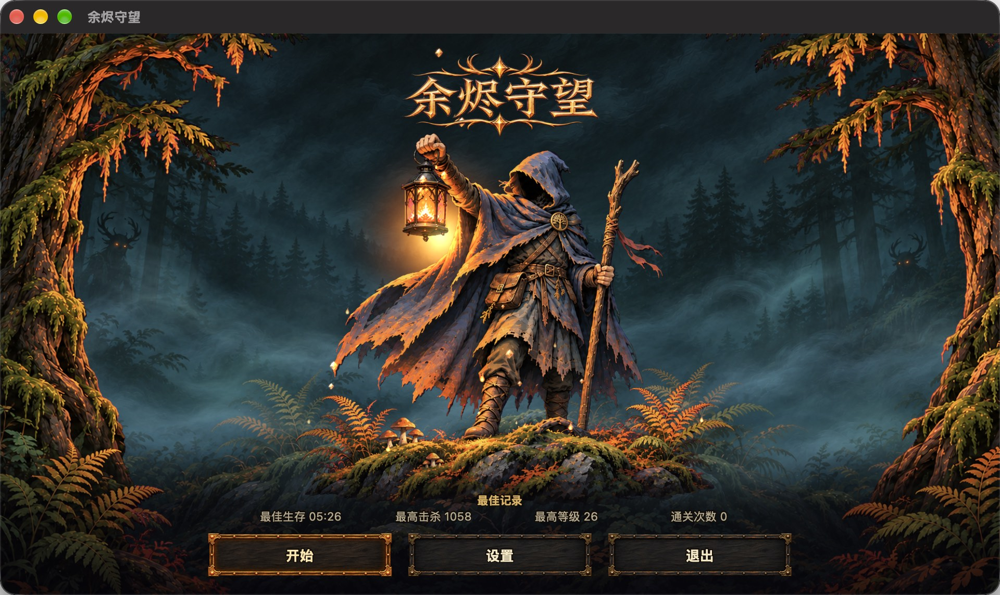

<h1 align="center">Ember Vigil</h1>

<p align="center">
  <strong>English</strong> |
  <a href="README.zh-CN.md">简体中文</a>
</p>

<p align="center">
  <a href="https://github.com/oneo-me"></a>
  <a href="https://oneo.me"></a>
  <a href="https://x.com/oneo666"></a>
  <a href="https://github.com/sponsors/oneo-me"></a>
</p>

<p align="center">
  A twelve-minute survivors-like 2D game: keep the last ember alive in an ash-choked forest, burn the shadows that come for it, and survive until dawn. Built in Go with <a href="https://github.com/nsgo-dev/nsgo">NSGo</a> and <a href="https://github.com/nsgo-dev/game">nsgo-dev/game</a>.
</p>

<p align="center">
  
</p>

## Features

- One twelve-minute run against a rising tide of shadow creatures, ending with the Hollow King at dawn.
- Four auto-firing weapons and eight passives, each with five levels, chosen from three cards on every level-up.
- Six enemy kinds, the Gloomwarden elite and a three-phase boss.
- Stylized 2D animated sprites and hand-painted forest environment in a lantern-lit ash grove.
- Keyboard, gamepad and touch controls, with English and Simplified Chinese interface.
- Embers paid by every run, best records and settings kept between sessions.
- Builds for macOS, Windows, Linux and the web.

The first version is complete; see the [roadmap](docs/roadmap.md) for what each milestone delivered and what comes later.

## Install

The game needs Go 1.27 and the toolchain versions pinned in `go.mod`.

```sh
git clone https://github.com/oneo-me/test-game-2.git
cd test-game-2
go tool nsgo dev
```

The window opens at 960×540. Run it in a browser or package release artifacts into `dist/` with:

```sh
go tool nsgo dev -target web
go tool nsgo build
```

Every push to `main` publishes the web version to GitHub Pages through [`.github/workflows/pages.yml`](.github/workflows/pages.yml), once the repository's Pages source is GitHub Actions.

## Getting started

1. Choose Start on the title screen.
2. Move with WASD, the arrow keys, a gamepad's left stick or the on-screen stick; weapons fire on their own.
3. Gather the embers enemies leave behind, then pick one of three upgrades at each level.
4. Keep the ember burning until 12:00 and defeat the Hollow King.

## Development

Run the tests and the cross-target checks from the repository root:

```sh
go tool nsgo test ./...
go tool nsgo check -target macos,windows,linux,web
```

Read [ARCHITECTURE.md](ARCHITECTURE.md) before changing code, [docs/requirements.md](docs/requirements.md) for the first version's scope, and [docs/roadmap.md](docs/roadmap.md) for the milestones. Agents also read [AGENTS.md](AGENTS.md).

See [CHANGELOG.md](CHANGELOG.md) for release notes.

## License

Ember Vigil is released under the [MIT License](LICENSE). Placeholder audio uses the `nsgo-dev/game` placeholder pack (Placeholder art and sound: NSGo Game contributors, CC0).
