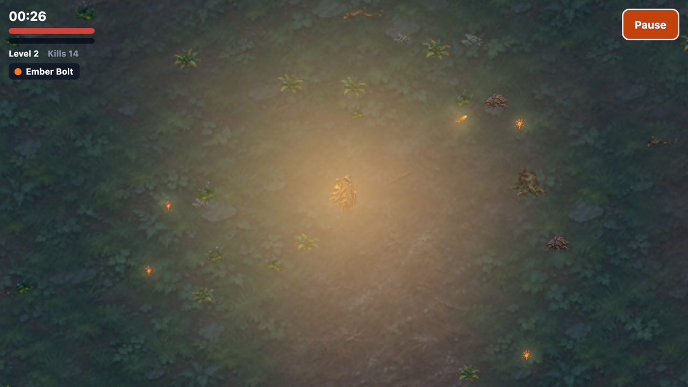

<h1 align="center">Ember Vigil</h1>

<p align="center">
  <strong>简体中文</strong> |
  <a href="README.md">English</a>
</p>

<p align="center">
  <a href="https://github.com/oneo-me"></a>
  <a href="https://oneo.me"></a>
  <a href="https://x.com/oneo666"></a>
  <a href="https://github.com/sponsors/oneo-me"></a>
</p>

<p align="center">
  一款十二分钟的类幸存者 2D 游戏：在灰烬森林里守住最后一簇余烬，烧尽扑向它的暗影，活到天亮。使用 Go、<a href="https://github.com/nsgo-dev/nsgo">NSGo</a> 和 <a href="https://github.com/nsgo-dev/game">nsgo-dev/game</a> 构建。
</p>

<p align="center">
  
</p>

## 功能

- 一局十二分钟，暗影生物越聚越多，黎明时直面空洞之王。
- 四件自动攻击的武器和八种被动，各五级；每次升级从三张卡里选一张。
- 六种敌人、幽卫精英和三阶段 Boss。
- 风格化 2D 手绘精灵动画与灰烬林地场景，由守夜人的提灯照亮。
- 键盘、手柄和触屏操作，界面支持英文和简体中文。
- 保存最佳记录和设置。
- 可构建到 macOS、Windows、Linux 和 Web。

首版已完成，各里程碑的交付内容与后续计划见[路线图](docs/roadmap.md)。

## 安装

需要 Go 1.27 和 `go.mod` 里锁定的工具链版本。

```sh
git clone https://github.com/oneo-me/test-game-2.git
cd test-game-2
go tool nsgo dev
```

窗口以 960×540 打开。在浏览器里运行，或将多平台构建产物打包到 `dist/`：

```sh
go tool nsgo dev -target web
go tool nsgo build
```

每次推送到 `main`，[`.github/workflows/pages.yml`](.github/workflows/pages.yml) 都会把 Web 版发布到 GitHub Pages，前提是存储库的 Pages 来源设为 GitHub Actions。

## 开始游玩

1. 在标题界面选择「开始」。
2. 用 WASD、方向键、手柄左摇杆或屏幕摇杆移动；武器会自动攻击。
3. 捡起敌人留下的余烬，每次升级从三张卡里选一张。
4. 让余烬烧到 12:00，击败空洞之王。

## 开发

在存储库根目录运行测试和跨目标检查：

```sh
go tool nsgo test ./...
go tool nsgo check -target macos,windows,linux,web
```

改代码前先读 [ARCHITECTURE.md](ARCHITECTURE.md)，首版范围见 [docs/requirements.md](docs/requirements.md)，里程碑见 [docs/roadmap.md](docs/roadmap.md)。Agent 还要读 [AGENTS.md](AGENTS.md)。

发布说明见 [CHANGELOG.md](CHANGELOG.md)。

## 许可证

Ember Vigil 以 [MIT 许可证](LICENSE)发布。占位音频来自 `nsgo-dev/game` 占位素材包（Placeholder art and sound: NSGo Game contributors, CC0）。
